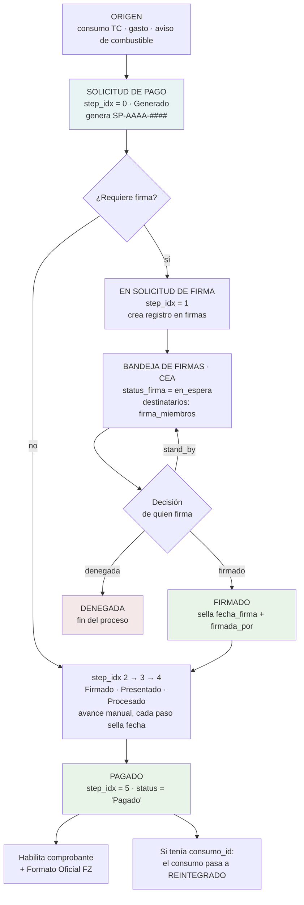
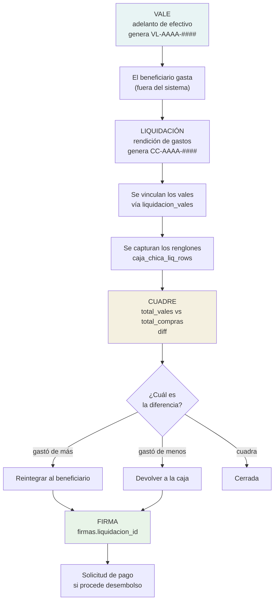
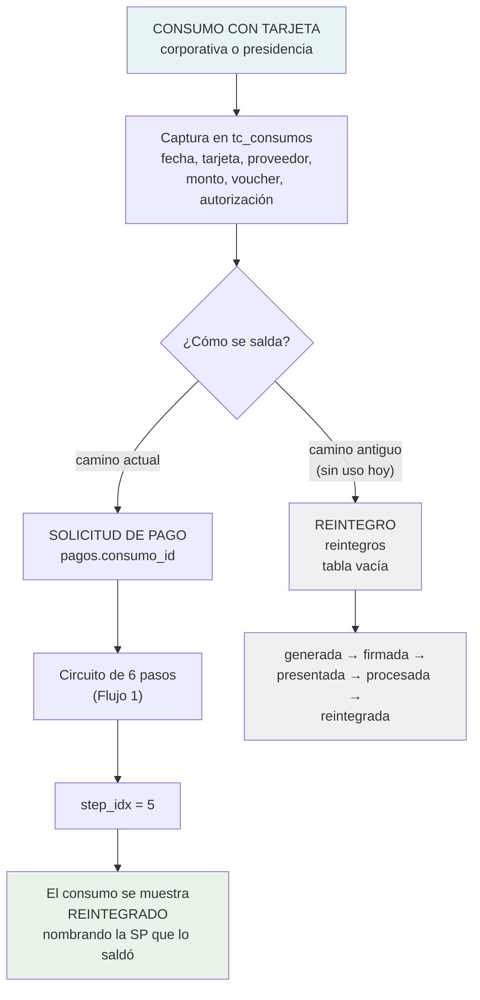
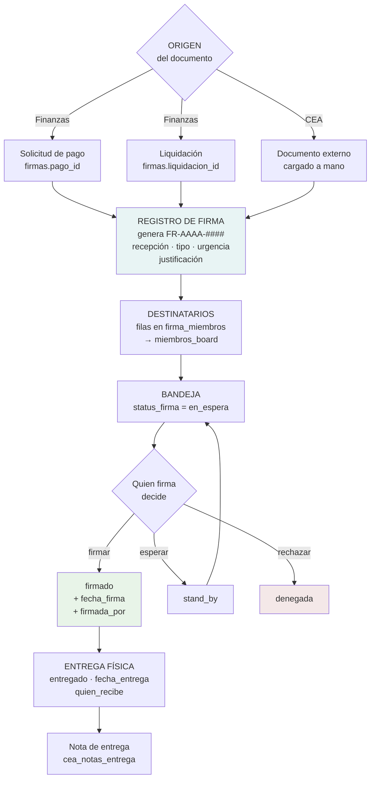
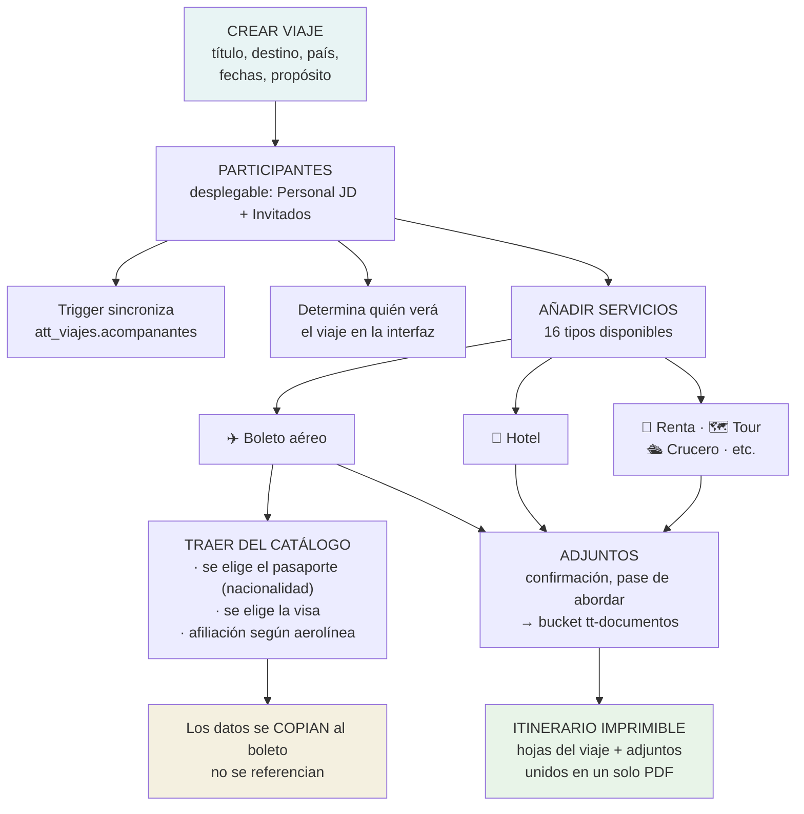
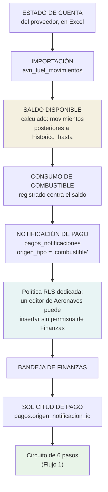
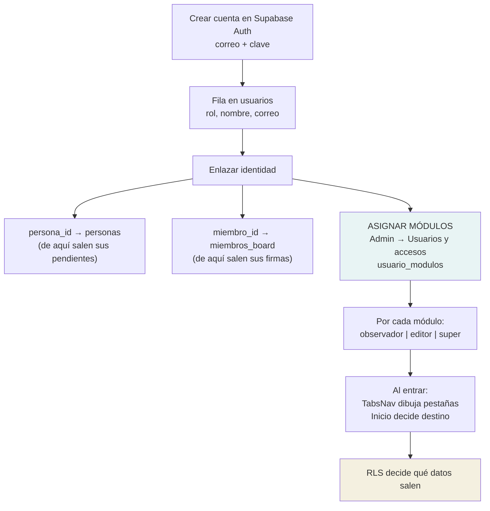

# E · Flujos de trabajo

Este documento contiene el **entregable 3: diagramas de los principales flujos**.

Para cada proceso: quién lo inicia, qué requiere, qué valida, qué genera, qué estados atraviesa, quién interviene, qué lo hace avanzar y cómo termina.

> Los diagramas están en Mermaid, que se renderiza en GitHub, en VS Code y en la mayoría de visores de Markdown. Quien lea en texto plano encontrará el flujo igualmente legible.

---

## Flujo 1 · Solicitud de pago hasta la firma

El proceso central del sistema.

| Aspecto | Detalle |
|---|---|
| **Quién inicia** | La asistente (rol `admin` o `asistente`) |
| **Qué requiere** | Proveedor, concepto, monto, moneda, tipo de pago, entidad, autorizador |
| **Validaciones** | Correlativo generado por el servidor · no se puede retroceder de paso · RLS exige rol operativo |
| **Documentos que genera** | Solicitud SP-AAAA-#### · registro de firma FR-AAAA-#### · Formato Oficial FZ (imprimible) |
| **Estados** | `step_idx` 0→5, con fecha sellada por paso |
| **Quién interviene** | Asistente (crea y avanza) · firmante con `puede('cea','editor')` |
| **Qué dispara el avance** | Acción manual en la interfaz. **No hay automatismo** entre la firma y el avance del paso |
| **Cómo termina** | Paso 5 con comprobante adjunto. No hay cierre contable posterior |

⚠️ **Punto de atención:** firmar el documento y avanzar la solicitud son dos acciones independientes. Que una firma esté en `firmado` no mueve `step_idx` por sí sola; alguien tiene que avanzarla a mano. Es un punto donde el proceso puede quedarse detenido sin que nada lo señale.

---

## Flujo 2 · Vale → liquidación → reintegro

| Aspecto | Detalle |
|---|---|
| **Quién inicia** | La asistente |
| **Qué requiere** | Beneficiario (empleado o entidad), monto, concepto, periodo |
| **Validaciones** | Correlativo del servidor · al borrar la liquidación, el trigger desvincula los vales |
| **Documentos** | Vale VL- · liquidación CC- · comprobante adjunto · firma FR- |
| **Estados del vale** | 13 valores posibles, **sin máquina de estados declarada** |
| **Quién interviene** | Asistente · firmante |
| **Cómo termina** | Liquidación cuadrada y firmada |

⚠️ **Dos observaciones:**
1. Los trece estados del vale no tienen transiciones restringidas por la base. La columna `estado_previo` sugiere que se revierte de estado, pero no se encontró la regla que lo gobierna.
2. Los renglones (`caja_chica_liq_rows`) y la unión (`liquidacion_vales`) **no están auditados**. El cuadre se puede alterar sin dejar rastro.

---

## Flujo 3 · Consumo de tarjeta hasta su saldo

**Las dos generaciones del modelo conviven.** El camino de la derecha (reintegros) está implementado y vacío; el de la izquierda es el que se usa. La interfaz tuvo que corregirse para reconocer ambos: antes marcaba como «vencido» un consumo saldado por el camino nuevo, porque sólo miraba el antiguo.

---

## Flujo 4 · Firma de un documento

| Aspecto | Detalle |
|---|---|
| **Quién inicia** | La asistente, o el proceso de Finanzas |
| **Qué requiere** | Tipo, urgencia (`urgente`/`importante`/`programado`), justificación, destinatarios |
| **Validaciones** | Correlativo del servidor · escribir exige `puede('cea','editor')` |
| **Estados** | `en_espera → firmado | stand_by | denegada` |
| **Quién interviene** | Quien crea el documento · quien firma · quien recibe el físico |
| **Qué dispara el siguiente paso** | Acción manual. **No hay notificación por correo** — ver abajo |
| **Cómo termina** | Firmado y entregado, con constancia de entrega |

⚠️ **Funcionalidad NO implementada, declarada como pendiente:** no existe notificación por correo ni al móvil cuando un documento entra a la bandeja de firma. El destinatario se entera entrando a la aplicación o porque alguien se lo dice. Está anotado en la lista de pendientes del proyecto, a la espera de un buzón corporativo.

⚠️ **Sin auditoría:** `firmas` y `firma_miembros` no tienen trigger. La firma deja constancia en la propia fila, pero esa fila es modificable sin registro.

---

## Flujo 5 · Planificación de un viaje

| Aspecto | Detalle |
|---|---|
| **Quién inicia** | La asistente |
| **Qué requiere** | Título, fechas, destino; el resto es incremental |
| **Validaciones** | Un participante es persona **o** invitado, nunca ambos (`CHECK`) |
| **Documentos** | Itinerario y hojas por servicio, con adjuntos incorporados al PDF |
| **Quién interviene** | Asistente (construye) · participantes (consultan) |
| **Cómo termina** | No tiene cierre formal. El viaje pasa a la carpeta de finalizados por fecha |

**Decisión de diseño que conviene entender:** al traer un pasaporte del catálogo, los datos **se copian** al boleto. Es deliberado: un boleto emitido es un documento histórico y debe seguir diciendo con qué pasaporte se voló aunque el catálogo cambie después.

---

## Flujo 6 · Combustible de aeronave hacia Finanzas

Es la única integración automatizada entre módulos.

**Verificación incorporada al proceso:** las migraciones que cargan estados de cuenta llevan su propia comprobación — si el saldo resultante no coincide con el declarado por el proveedor, la migración lanza una excepción y no guarda nada. Es una práctica que vale la pena señalar como acierto.

**Excepción documentada al borrado suave:** `pagos_notificaciones` sí se marcan como procesadas de forma definitiva, por ser una bandeja de avisos y no un registro contable.

---

## Flujo 7 · Alta de usuario y asignación de accesos

| Aspecto | Detalle |
|---|---|
| **Quién inicia** | Sólo el administrador |
| **Validaciones** | Un usuario **no puede cambiarse el rol a sí mismo** (política `usuarios_self_update`) |
| **Quién interviene** | Administrador |
| **Cómo termina** | El usuario entra y ve lo que su rol y sus módulos permiten |

⚠️ **Sin auditoría:** la tabla `usuarios` **no tiene trigger de auditoría**. Un cambio de rol no queda registrado en `audit_log`. `usuario_modulos` **sí** lo tiene.

Es una asimetría llamativa: se registra quién recibió permiso sobre un módulo, pero no quién fue promovido a administrador.
