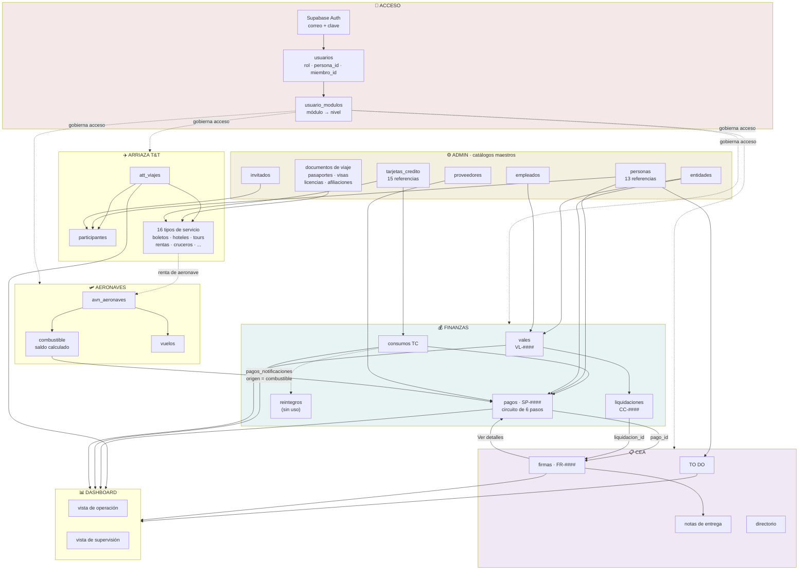
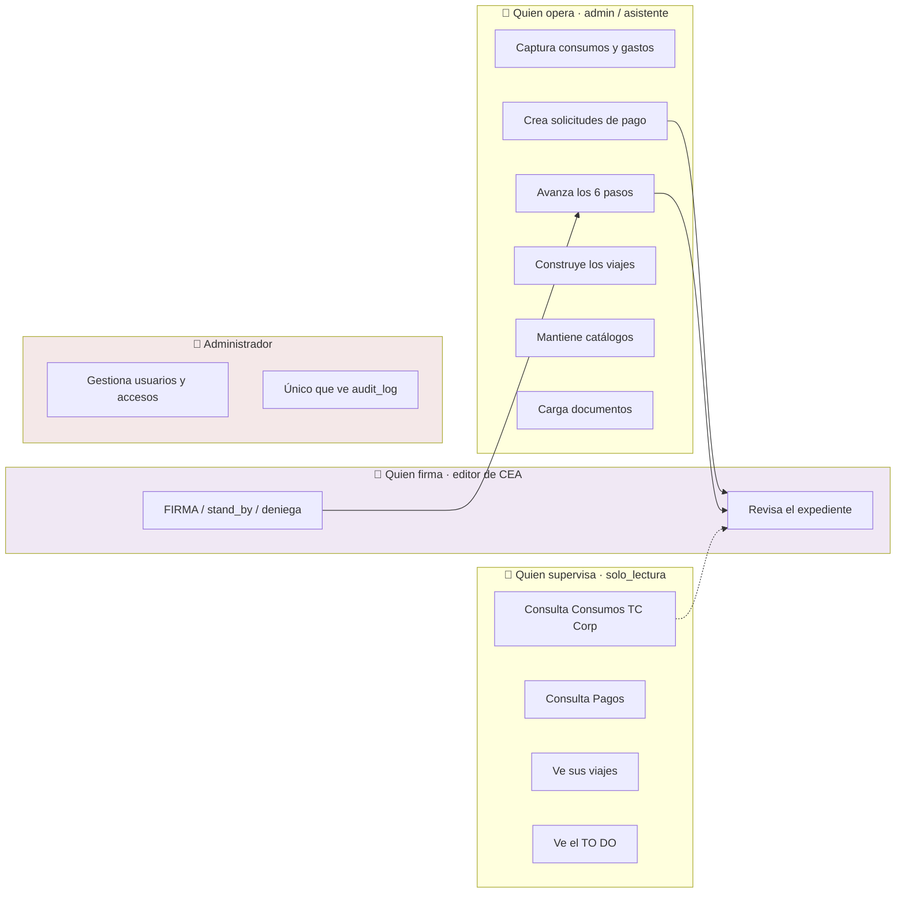

# J · Mapa general de CEA

Este documento contiene el **entregable 2: mapa visual de módulos y dependencias**.

---

## 1 · Mapa completo del sistema



---

## 2 · Los módulos y su peso

| Módulo | Tablas | Archivos | Correlativo | Puerta de acceso |
|---|---:|---:|---|---|
| Arriaza T&T | 46 | 164 | — | `puede('tt', …)` |
| Aeronaves | 12 | 29 | varios | `puede('aeronaves', …)` |
| Finanzas | 12 | 27 | SP- VL- CC- | rol + `puede('finanzas')` |
| CEA | 10 | 29 | FR- | `puede('cea', …)` |
| Admin | 8 | 21 | — | rol `admin` |
| Caja Chica | 3 | 6 | periodo | `puede('caja_chica')` |
| Dashboard | — | 7 | — | `puede('dashboard')` |
| Miel SJ | 1 | 5 | — | `puede('miel_sj')` |

---

## 3 · Flujos de información principales

```
                  ┌──────────────────────────────────┐
                  │  ADMIN · catálogos maestros      │
                  │  personas · tarjetas · entidades │
                  │  proveedores · empleados         │
                  │  invitados · docs de viaje       │
                  └───┬────────────────────────┬─────┘
          alimenta    │                        │   alimenta
       ┌──────────────┘                        └──────────────┐
       ▼                                                      ▼
┌──────────────┐                                    ┌──────────────────┐
│ ARRIAZA T&T  │                                    │    FINANZAS      │
│              │                                    │                  │
│ viaje        │                                    │ consumo TC ──┐   │
│  ├ particip. │◄── determina quién lo ve           │              │   │
│  └ servicios │                                    │ vale ─► liq. │   │
└───────┬──────┘                                    │              │   │
        │                                           │     solicitud│   │
        │ resumen                                   │     de pago ◄┘   │
        │                                           └────┬────────┬────┘
        │                                                │        │
        │                               genera firma     │        │ si se paga
        │                                                ▼        │ y venía de
        │                                        ┌──────────────┐ │ un consumo
        │                                        │     CEA      │ │     │
        │                                        │              │ │     ▼
        │                                        │ firmas ◄─────┘ │ consumo pasa
        │                                        │   │            │ a REINTEGRADO
        │                                        │   │ Ver detalles
        │                                        │   └────────────┘
        │                                        │ TO DO          │
        │                                        └───────┬────────┘
        │                                                │
        └────────────────────┬───────────────────────────┘
                             ▼
                  ┌─────────────────────┐
                  │     DASHBOARD       │
                  │   sólo consume      │
                  └─────────────────────┘

        ┌──────────────┐
        │  AERONAVES   │──── aviso de combustible ───► FINANZAS
        └──────────────┘     (única integración
                              automatizada)
```

---

## 4 · Dónde interviene cada persona



---

## 5 · Procesos que llegan a Presidencia para aprobación o firma

Son **tres**, y los tres convergen en la misma bandeja de CEA.

```
┌────────────────────────────────────────────────────────────┐
│ 1 · SOLICITUD DE PAGO                                      │
│     Finanzas → firmas.pago_id                              │
│     Paso 1 del circuito: «En Solicitud de Firma»           │
│     Se firma → la solicitud pasa sola a «Firmado»          │
└────────────────────────────────────────────────────────────┘

┌────────────────────────────────────────────────────────────┐
│ 2 · LIQUIDACIÓN DE CAJA CHICA                              │
│     Finanzas → firmas.liquidacion_id                       │
│     Cuando el cuadre exige reintegro o devolución          │
└────────────────────────────────────────────────────────────┘

┌────────────────────────────────────────────────────────────┐
│ 3 · DOCUMENTO EXTERNO                                      │
│     CEA → firma creada a mano                              │
│     Contratos, cartas, cualquier papel que requiera firma  │
└────────────────────────────────────────────────────────────┘
                              │
                              ▼
              ┌───────────────────────────────┐
              │   BANDEJA DE FIRMAS · CEA     │
              │   status_firma = en_espera    │
              │   urgencia: urgente /         │
              │   importante / programado     │
              └───────────────┬───────────────┘
                              ▼
              ┌───────────────────────────────┐
              │   firmado | stand_by |        │
              │   denegada                    │
              │   sella fecha_firma +         │
              │   firmada_por                 │
              └───────────────┬───────────────┘
                              ▼
              ┌───────────────────────────────┐
              │   ENTREGA FÍSICA              │
              │   cea_notas_entrega           │
              └───────────────────────────────┘
```

### Tres observaciones sobre este circuito

1. **No hay aviso automático.** Nadie recibe correo ni notificación al móvil. Quien firma se entera entrando a la aplicación. Está anotado como pendiente del proyecto.

2. ~~**La firma no avanza el pago.**~~ **Resuelto el 5 nov 2026 (fase 43).** Un trigger de base avanza la solicitud a «Firmado» cuando se completan todas sus firmas. Los pasos siguientes se avanzan a mano a propósito: son actos administrativos fuera del sistema.

3. **La firma no deja rastro de auditoría.** `firmas` no tiene trigger. La evidencia vive en la propia fila, que es modificable por cualquier editor de CEA.

---

## 6 · Cómo leer este sistema en diez minutos

Para un revisor que empieza, el orden que rinde más:

1. **`personas`** — el eje. Trece referencias; conecta identidad, viajes, finanzas y documentos.
2. **El circuito de seis pasos de `pagos`** — el proceso central del negocio.
3. **`firmas` y `firma_miembros`** — dónde converge toda autorización.
4. **La función `puede()`** y las 104 políticas RLS — lo único que de verdad controla el acceso.
5. **`att_viajes`** y sus 24 referencias — el módulo más grande, estructuralmente repetitivo: entender un servicio es entender los dieciséis.

**Y una advertencia:** no evaluar la seguridad desde la interfaz. Hay al menos dos casos donde lo que la pantalla oculta, la API entrega.
